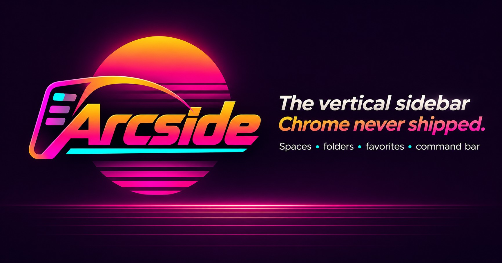
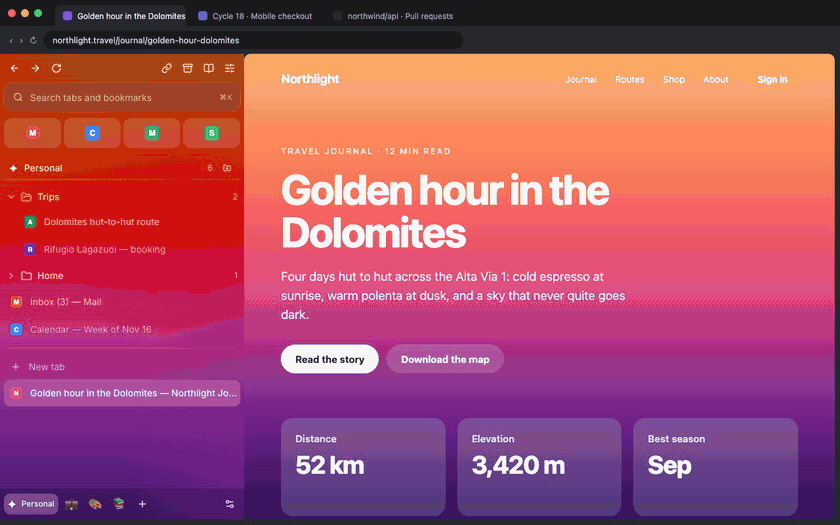
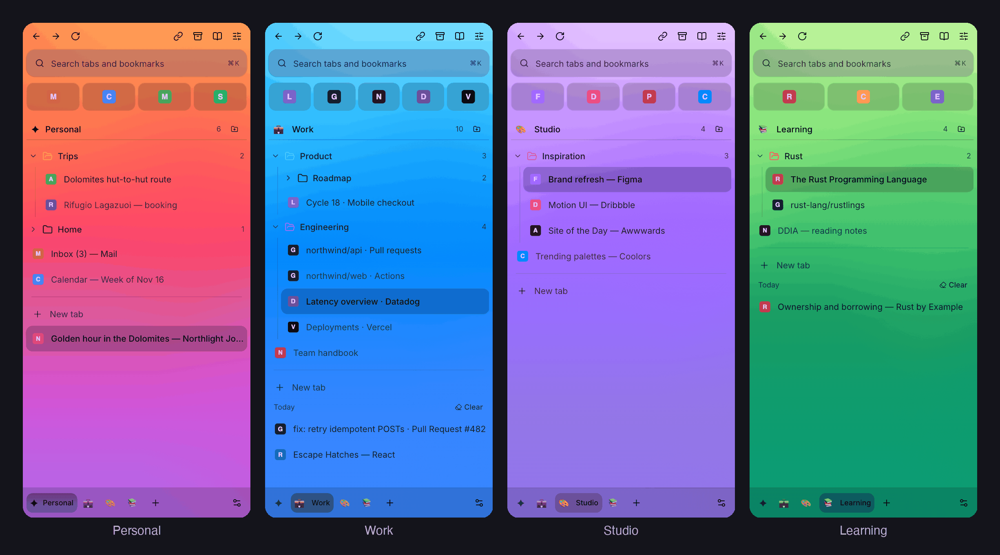
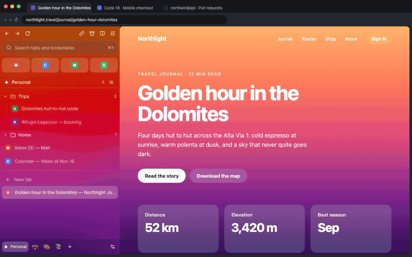
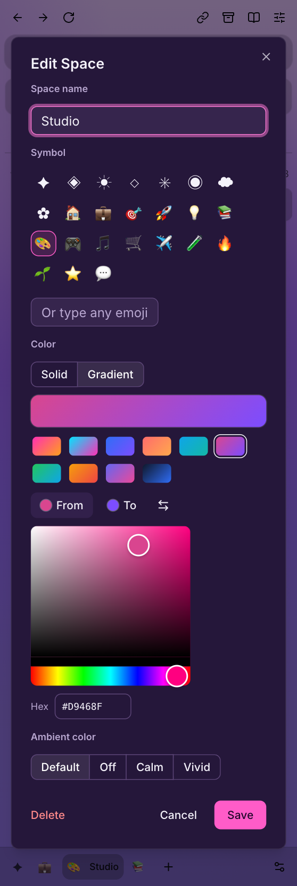
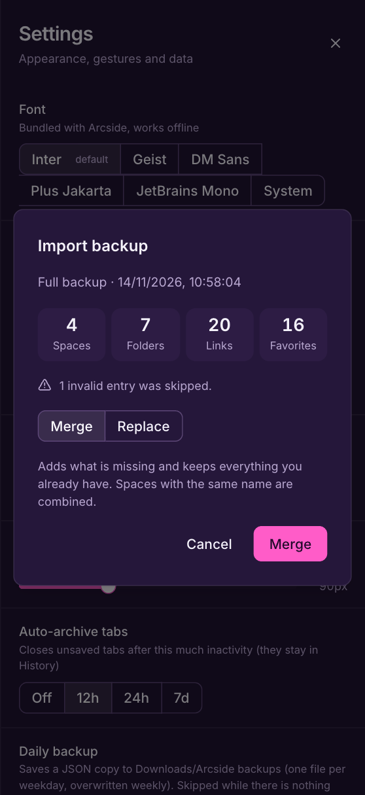
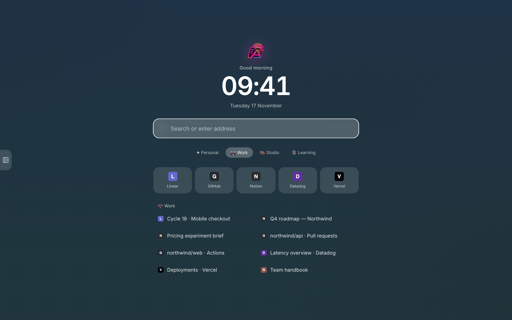

<div align="center">

<h1>
  
</h1>

**Spaces, folders, favorites and a command bar in Chrome's own side panel, tinted by the page you're on.**




[Features](#features) · [Install](#install) · [Shortcuts](#shortcuts) · [Privacy](#privacy-and-permissions) · [FAQ](#faq) · [Development](#development) · [Changelog](CHANGELOG.md)

</div>

## Why Arcside

If you like how Arc organizes tabs but live in Chrome, this is the missing piece. Arcside is a regular Manifest V3 extension, so you keep your extensions, your profile and your sync. It adds a sidebar that groups your work into Spaces and gets out of the way.

- **Stay on Chrome.** It lives in the native side panel. Nothing to migrate, nothing to trust except the extension.
- **Organized by default.** Split work, personal life and side projects into Spaces. Pin what matters into nested folders. Unsaved tabs stay under *Today*, ready to clear.
- **Fast.** Keyboard-first, instant search, a command palette that also opens over any web page.
- **Private.** No server, no account, no analytics. Everything stays in your browser.

## Features

### Spaces that follow your page

Each Space has its own tabs, folders, saved links and Favorites. The sidebar background picks up the colors along the left edge of the page you're viewing, in 16 smoothly animated zones with a soft drifting aura, and the text re-contrasts itself automatically.



- Switch with a click, a two-finger swipe (with live preview), `Ctrl+Alt+←/→`, or by dragging a tab onto a Space.
- Switching returns you to the last tab you used there and reuses an empty tab if the Space has none.
- New tabs land in the Space you're in. After a Chrome restart they return to the Space they were in, matched by URL.

### One palette to jump anywhere

`Cmd+K` searches open tabs and saved links and runs commands. `Cmd+Shift+K` opens the same palette over any web page.



### Make every Space yours

Give each Space a name, an emoji, and a solid color or a custom gradient (color picker, eight presets, swap). Choose **Calm** or **Vivid** ambient globally, or override it per Space, including turning it off.



### Backups you can trust

Export everything or just one Space as JSON. Import shows a preview first (Spaces, folders, links, Favorites, export date, skipped entries), then lets you **merge** into what you have or **replace** it. Both are undoable with `Cmd+Z`. A daily copy goes to `Downloads/Arcside backups/`.



### A new tab worth opening

A clean page with search, your Favorites and the saved links of the active Space, plus a button to open or close the sidebar.



<details>
<summary><strong>Everything else</strong></summary>

- **Saved tabs and folders.** Permanent tabs per Space in nested folders with colors and drag-and-drop reordering, plus "Move to…" and "Open all". Clicking a saved tab opens or reactivates it, and closing it never deletes it.
- **Favorites.** A tile grid per Space with its own title and URL, independent of Chrome bookmarks.
- **Today.** The unsaved tabs of the active Space, with one-click *Clear* and *Duplicates*.
- **Undo.** `Cmd+Z` reverts removed Favorites and saved tabs, deleted folders, closed tabs and backup imports.
- **History.** Recently closed tabs, plus an automatic archive of inactive unsaved tabs (12 h by default).
- **Bookmarks.** Import from HTML with folders, export HTML per Space with Favorites in a dedicated folder.
- **Preview.** `Alt+click` a link to open it in a popup window.
- **Interface.** Bundled fonts (Inter, Geist, DM Sans, Plus Jakarta Sans, JetBrains Mono, System), full keyboard navigation and reduced-motion support.

</details>

## Install

Arcside isn't on the Chrome Web Store yet, so you load it as an unpacked extension. You need Chrome **116 or newer**.

### From a release

1. Download `arcside-chrome-<version>.zip` from the [latest release](https://github.com/dbbd59/arcside/releases/latest) and extract it into a folder you won't move.
2. Open `chrome://extensions` and turn on **Developer mode**.
3. Click **Load unpacked** and pick the extracted folder.
4. Pin the Arcside icon and click it to open the side panel.

### From source

You also need [Bun](https://bun.sh).

```bash
git clone https://github.com/dbbd59/arcside.git
cd arcside
bun install
bun run build
```

Then follow steps 2 to 4 above and pick the `dist/` folder. `bun run package` creates the release zip in `release/`.

> [!NOTE]
> The extension ID depends on the folder you load. Loading it from another path makes Chrome treat it as a new extension and your data doesn't follow. Use **Settings → Backup → Export all**, then **Import**.

## Shortcuts

| Key | Action |
|---|---|
| `Cmd+Shift+D` | Open the panel |
| `Cmd+Shift+K` | Palette over the page |
| `Cmd+Shift+C` | Copy the active tab's link |
| `Cmd+K` | Palette in the panel |
| `Cmd+Z` | Undo the last action |
| `Ctrl+Alt+←/→` | Previous or next Space |
| `/` | Search |

On Windows and Linux use `Ctrl` for `Cmd`. Change the global ones at `chrome://extensions/shortcuts`.

## Privacy and permissions

Arcside has no server, no account and no analytics. Read the full [privacy policy](PRIVACY.md). The only network request it can make is an optional `/favicon.ico` fetch from the sites of your saved links, which you can turn off in Settings.

| What | Where | Lifetime |
|---|---|---|
| Spaces, folders, saved tabs, Favorites, settings, archive | `chrome.storage.local` | Chrome profile |
| Favicon cache, per-URL Space memory | `chrome.storage.local` | Chrome profile |
| Tab → Space, tabs bound to saved items, active Space per window | `chrome.storage.session` | Browser session |
| Chrome bookmarks | Chrome API | Managed by Chrome |

<details>
<summary><strong>Why each permission is needed</strong></summary>

| Permission | Used for |
|---|---|
| `sidePanel` | The sidebar itself |
| `tabs`, `sessions` | Listing, activating and restoring tabs, and recently closed tabs |
| `bookmarks` | The bookmark library and HTML import and export |
| `storage` | Saving your Spaces and settings locally |
| `favicon` | Showing site icons from Chrome's own cache |
| `alarms`, `downloads` | The inactive-tab archive and the daily backup |
| `offscreen`, `clipboardWrite` | Copying a tab's link |
| `scripting`, `search` | The palette over web pages and the new tab search |
| `<all_urls>` and a content script on web pages | Reading the page's edge colors for the ambient effect, missing favicons and the in-page palette. The script only samples a few background colors and sends no page content anywhere |

</details>

## FAQ

<details>
<summary><strong>Is Arcside a browser?</strong></summary>
No. It's a Chrome extension that lives in the side panel. It is not affiliated with Arc or The Browser Company.
</details>

<details>
<summary><strong>Does it sync between my devices?</strong></summary>
Not yet. Data lives in the local profile. To move it, export a backup on one machine and import it on the other.
</details>

<details>
<summary><strong>The ambient colors look wrong on one page.</strong></summary>
Solid-color pages are read from the page itself. Anything with images, video or gradients falls back to a local screenshot, which can be off on busy pages. Switch to Calm, lower the intensity, or turn ambient off for that Space from its editor.
</details>

<details>
<summary><strong>The panel doesn't reopen after I restart Chrome.</strong></summary>
Chrome only lets extensions open the side panel from a user gesture. Click the icon or use <code>Cmd+Shift+D</code>.
</details>

<details>
<summary><strong>Does it work in Edge, Brave or Arc?</strong></summary>
Arcside targets Chrome 116 and newer. Other Chromium browsers that ship the side panel API may work, but they're untested.
</details>

## Development

Built with React 19, TypeScript 7, Vite 8, Tailwind 4, shadcn/ui and Bun.

```bash
bun run dev          # Vite dev server
bun run build        # typecheck + build into dist/
bun run typecheck
bun run lint         # oxlint
bun test             # unit tests (bun:test)
bun run package      # distributable zip
bun run docs:media   # regenerate the README screenshots and GIFs
```

<details>
<summary><strong>Project structure</strong></summary>

```text
src/
├── App.tsx, newtab.tsx             # panel and new tab entry points
├── bootstrap.tsx                   # shared root: error boundary, tooltips, confirm dialogs
├── background.ts                   # service worker: session, archive, backups, palette, copy link
├── overlay.ts                      # in-page palette (standalone)
├── ambient-probe.ts                # content script: scroll signal and solid-color sampling
├── hooks/                          # useArcside + actions per area (tab, Space, library), store, undo
├── components/                     # UI (ui/ = shadcn)
└── lib/                            # models and stores, folders, selectors, preference ops,
                                    # bookmarks/HTML, urls, tabs, favicons, ambient, contrast, backup
scripts/docs/                       # fake-data harness that renders the README media
docs/brand/                         # logo, mark and banner artwork
```

</details>

<details>
<summary><strong>How the README media is made</strong></summary>

`bun run docs:media` serves the built extension next to a mock Chrome window, injects a fake `chrome.*` API with made-up data (Spaces, tabs, bookmarks), then records the real UI with Playwright and ffmpeg. It needs Python with `playwright`, Google Chrome and `ffmpeg`. Run `bun run build` first. The output lands in `docs/`.

</details>

## License

[MIT](LICENSE) © 2026 Davide Bolzoni
